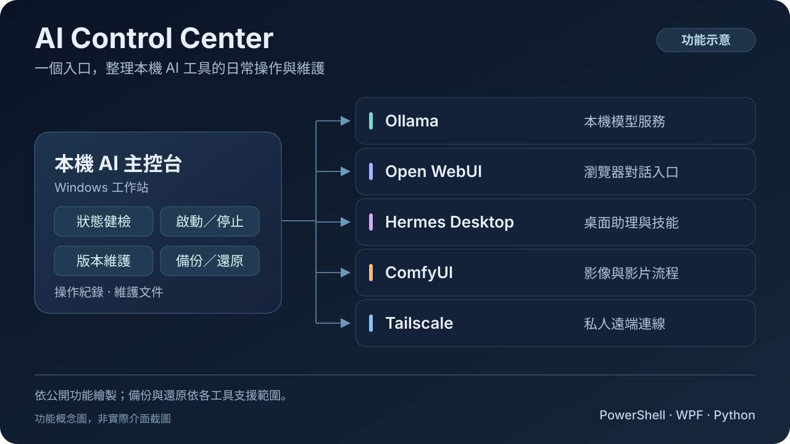
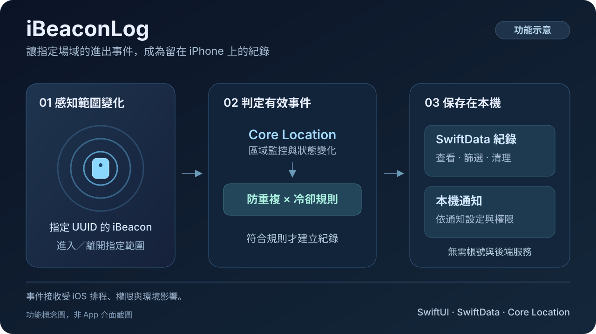

# Elton Chung

**IT 主管 · 系統開發與整合 · 軟體工程**  
**IT Manager · System Development & Integration · Software Engineering**

持續參與軟體開發的 IT Manager，現居台灣。工作重心是系統開發與整合、軟體工程及團隊與專案管理，領域涵蓋 FinTech／Payment、Cloud 與資訊安全。

I'm a Taiwan-based IT manager who stays actively involved in software development. My work focuses on system development and integration, software engineering, and team and project management, spanning fintech and payments, cloud computing, and information security.

工作之外，我也開發個人工具、iOS App 與遊戲，並將 AI-assisted Development 用在實作與迭代中。最近持續探索 AI Agents 與 Automation，關注如何讓這些工具融入實際的開發流程。

Outside of work, I build personal tools, iOS apps, and games, using AI-assisted development to support implementation and iteration. I'm also exploring AI agents and automation, with a focus on how they fit into practical development workflows.

## 背景與關注領域 · Background & Interests

- 系統開發與整合 · System Development & Integration
- 軟體工程、工程與專案管理 · Software Engineering, Engineering & Project Management
- 金融科技／支付、雲端、資訊安全 · Fintech / Payments, Cloud, Information Security
- AI 輔助開發、AI 代理、自動化 · AI-assisted Development, AI Agents, Automation
- PMP · ISO 27001

## 精選專案 · Featured Projects

### [Slow Journey（WJ）— 旅行探索遊戲 · Travel Exploration Game](https://github.com/eltonchung/slow-journey-showcase)

以散步、攝影與旅行手帳為核心的原生 iOS 遊戲。在山城、海港與森林中交談、觀察與拍照，讓自己的照片參與故事，也留下可以回看的旅程紀錄。目前前三章已接入可玩流程，整體仍持續開發中。

A native iOS game centered on walking, photography, and travel journaling. Explore mountain towns, harbors, and forests through conversations, observation, and photography. Your photos become part of the story and a travel journal you can revisit. The first three chapters are playable, and development is ongoing.

工程重點包括攝影與任務共用證據規則、跨章照片與進度保存，以及避免非同步寫入覆蓋新資料。公開 repository 提供作品畫面、功能與技術設計說明，完整原始碼保留私有。

Engineering highlights include shared evidence rules for photography and quests, photo and progress persistence across chapters, and safeguards against asynchronous writes overwriting newer data. The public repository includes screenshots, feature descriptions, and technical design notes; the full source code remains private.

Swift · SpriteKit · SwiftUI · iOS

[功能介紹 / Features](https://github.com/eltonchung/slow-journey-showcase/blob/main/FEATURES.md) · [技術架構 / Architecture](https://github.com/eltonchung/slow-journey-showcase/blob/main/ARCHITECTURE.md) · [畫面展示 / Gallery](https://github.com/eltonchung/slow-journey-showcase/blob/main/GALLERY.md) · [驗證範圍 / Validation Scope](https://github.com/eltonchung/slow-journey-showcase/blob/main/QUALITY.md)

### [雀山奇譚 — Taiwan Mahjong](https://github.com/eltonchung/TaiwanMahjong-Showcase)

以 Swift／SwiftUI 開發的單機台灣十六張麻將 iOS App，結合賽事內技能成長、玩家可決定結果的突發事件、具不同打法的 AI 牌友與牌譜回顧。

A single-player iOS app for Taiwanese 16-tile mahjong, built with Swift and SwiftUI. It combines skill progression within tournaments, unexpected events whose outcomes depend on player choices, AI opponents with distinct play styles, and game replay review.

工程重點包括規則與畫面分離、可取消的背景手牌分析，以及局末保存與資料復原。公開 repository 提供產品與技術展示，完整原始碼保留私有。

Engineering highlights include separating game rules from the UI, cancellable background hand analysis, and end-of-round saving and data recovery. The public repository showcases the product and its technical design; the full source code remains private.

Swift · SwiftUI · iOS · 遊戲開發 / Game Development

[功能介紹 / Features](https://github.com/eltonchung/TaiwanMahjong-Showcase/blob/main/FEATURES.md) · [技術架構 / Architecture](https://github.com/eltonchung/TaiwanMahjong-Showcase/blob/main/ARCHITECTURE.md) · [畫面與影片 / Screenshots & Videos](https://github.com/eltonchung/TaiwanMahjong-Showcase/blob/main/GALLERY.md) · [驗證範圍 / Validation Scope](https://github.com/eltonchung/TaiwanMahjong-Showcase/blob/main/QUALITY.md)

### [AI Control Center — 本機 AI 工具管理 · Local AI Tool Manager](https://github.com/eltonchung/ai-control-center)

Windows 桌面工具，集中查看 Ollama、Open WebUI、Hermes Desktop、ComfyUI 與 Tailscale 的狀態，並依各工具的支援範圍提供啟停、版本檢查、更新及備份復原流程。

A Windows desktop tool for viewing the status of Ollama, Open WebUI, Hermes Desktop, ComfyUI, and Tailscale in one place. It provides start/stop controls, version checks, updates, and backup and recovery workflows, depending on what each tool supports.

PowerShell 5.1 · WPF · Python 3.11

公開 repository 提供原始碼、部署與操作文件。

The public repository includes source code, deployment instructions, and usage documentation.

### [Boardmarks — 書籤工作台 · Bookmark Workspace](https://github.com/eltonchung/boardmarks)

以 Chrome 原生書籤為基礎的新分頁擴充功能，將工作空間、分類收藏與開啟中的分頁放在同一個畫面。支援拖曳收藏、整個視窗保存、全域搜尋及 Toby 匯入，讓整理好的資料能在下次工作時接著使用。

A Chrome new-tab extension built on native bookmarks, bringing workspaces, organized collections, and open tabs into one view. It supports drag-and-drop bookmarking, saving all tabs in a window, global search, and imports from Toby, so you can pick up where you left off.

React · TypeScript · Vite · Chrome Manifest V3

專案內提供介面截圖、安裝指南、架構說明與測試文件。

The repository includes interface screenshots, an installation guide, architecture notes, and test documentation.

### [iBeaconLog — iBeacon 進出紀錄工具 · iBeacon Entry & Exit Logger](https://github.com/eltonchung/BeaconLogger-Showcase)

依指定 iBeacon 範圍變化建立進出紀錄的 iOS App，整合本機儲存、通知、冷卻與防重複機制，並提供 Beacon 命名、訊號診斷及資料管理功能。

An iOS app that logs entry into and exit from specified iBeacon regions. It combines local storage, notifications, cooldowns, and duplicate prevention, with beacon naming, signal diagnostics, and data management features.

Swift 6 · SwiftUI · SwiftData · Core Location · UserNotifications

公開 repository 提供功能與技術設計說明，完整原始碼保留私有。

The public repository includes feature descriptions and technical design notes; the full source code remains private.
