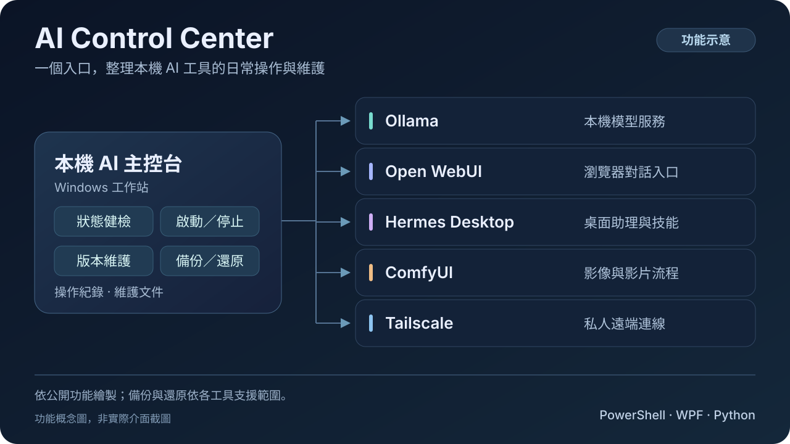
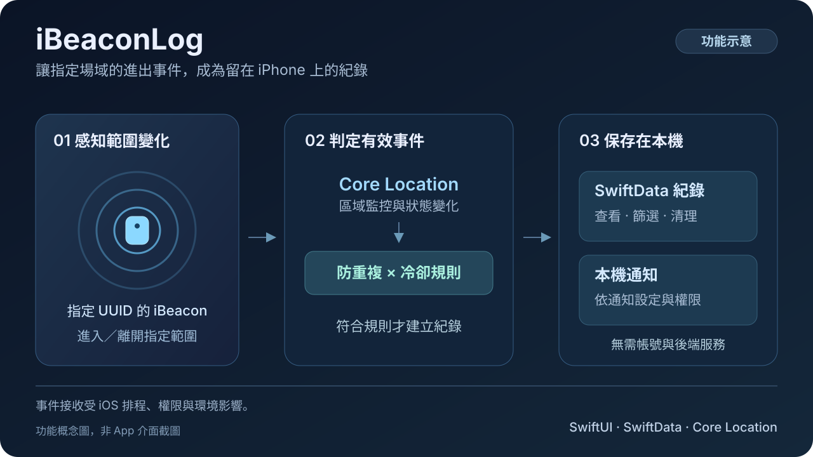

# Elton Chung

**IT Manager · Software Engineering · System Integration**  
**IT 主管 · 軟體工程 · 系統整合**

把實際需求，做成可使用、可維護的工具與作品。  
*Turning practical needs into useful, maintainable software.*

## 關於我 · About

我是一位在台灣、持續投入軟體實作的 IT 主管，專注系統開發與整合、軟體工程，以及團隊與專案管理。工作領域涵蓋金融科技與支付、雲端及資訊安全；工作之外，我也開發 iOS App、遊戲與日常工具，把想法帶進實際使用情境。

I'm a Taiwan-based IT manager who stays hands-on with software development. My work spans system integration, software engineering, and team and project management across fintech, payments, cloud, and information security. Outside of work, I build iOS apps, games, and practical tools.

我使用 AI 輔助開發來加快實作與迭代，同時重視需求釐清、測試、資料保護與文件。

I use AI-assisted development to accelerate implementation and iteration, while keeping requirements, testing, data protection, and documentation part of the process.

## 專業與技術 · Expertise & Toolkit

| 領域 · Area | 技術與實務 · Technologies & Practice |
| --- | --- |
| 原生 App 與遊戲 · Native Apps & Games | Swift · SwiftUI · SpriteKit · SwiftData · Core Location |
| 網頁與工具 · Web & Utilities | PHP / Laravel · React · TypeScript · Python · PowerShell / WPF |
| 系統整合與交付 · Integration & Delivery | Linux · Docker · CI/CD · AWS · GCP |
| 管理與治理 · Management & Governance | Team & Project Management · Information Security · PMP · ISO 27001 |

## 旗艦作品 · Featured Projects

### [Slow Journey｜旅行探索遊戲 · Travel Exploration Game](https://github.com/eltonchung/slow-journey-showcase)

`iOS` `Swift` `SpriteKit` `SwiftUI` · **開發中展示 / In-development showcase**

散步、攝影與旅行手帳結合的原生 iOS 遊戲。探索山城、海港與森林，透過觀察、交談與拍照推進故事，並保存跨章節的照片與旅程紀錄；目前前三章已接入可玩流程。

A native iOS exploration game built around walking, photography, and travel journaling. Discover stories across mountain towns, harbors, and forests, with photos and progress preserved between chapters. The first three chapters are playable; development is ongoing.

*2026-10-01 iPhone 模擬器實際操作畫面。 / Captured in the iPhone simulator on October 1, 2026.*

[作品與功能 / Explore](https://github.com/eltonchung/slow-journey-showcase) · [更多畫面 / Gallery](https://github.com/eltonchung/slow-journey-showcase/blob/main/GALLERY.md) · [技術架構 / Architecture](https://github.com/eltonchung/slow-journey-showcase/blob/main/ARCHITECTURE.md)

---

### [雀山奇譚｜Taiwan Mahjong](https://github.com/eltonchung/TaiwanMahjong-Showcase)

`iOS` `Swift` `SwiftUI` `Game Development` · **產品展示 / Product showcase**

單機台灣十六張麻將，結合賽事內技能成長、有不同打法的 AI 牌友，以及由玩家決定結果的突發事件。從牌桌操作到牌譜回顧，探索傳統玩法與遊戲系統設計的結合。

A single-player Taiwanese 16-tile mahjong game with tournament-based skill progression, AI opponents with distinct play styles, and events shaped by player decisions. It combines familiar table play with new strategic choices and replay review.

*實際 App 介面，使用示範玩家與牌局資料；不是實際玩家戰績。 / Actual app UI with demonstration players and game data, not real player results.*

[作品與玩法 / Explore](https://github.com/eltonchung/TaiwanMahjong-Showcase) · [畫面與影片 / Gallery](https://github.com/eltonchung/TaiwanMahjong-Showcase/blob/main/GALLERY.md) · [技術架構 / Architecture](https://github.com/eltonchung/TaiwanMahjong-Showcase/blob/main/ARCHITECTURE.md)

---

### [OpenPlanTeam｜專案規劃工作台 · Project Planning Workspace](https://github.com/eltonchung/OpenPlanTeam-Showcase)

`React` `TypeScript` `Zustand` `Vite` · **本機試行版展示 / Local-trial showcase**

以 OpenPlan 為基礎延伸開發的瀏覽器專案規劃工具，整合甘特圖、任務看板、資源負載、基準比較與交接報告。加入繁體中文工作流程、匯入驗證與報表功能，讓時程、資源衝突及交接資訊更容易掌握；並非即時多人協作服務。

A browser-based planning tool extended from OpenPlan, combining Gantt scheduling, task boards, resource workloads, baseline comparisons, and handoff reports. It adds Traditional Chinese workflows, import validation, and reporting. It runs locally in the browser, not as a real-time collaboration service.

*實際程式截圖，採用完全虛構的 Atlas Portal 示範專案。 / Actual application capture using the entirely fictional Atlas Portal project.*

基於 **MNS Baanu** 的 [OpenPlan](https://github.com/MNSBaanu/OpenPlan) 延伸開發，保留原作來源與授權聲明。 / Built on **OpenPlan by MNS Baanu**, with upstream attribution and license notices retained.

[作品介紹 / Explore](https://github.com/eltonchung/OpenPlanTeam-Showcase) · [功能與畫面 / Feature Tour](https://github.com/eltonchung/OpenPlanTeam-Showcase/blob/main/docs/FEATURE-TOUR.md) · [公開範圍 / Public Scope](https://github.com/eltonchung/OpenPlanTeam-Showcase/blob/main/docs/PUBLIC-SCOPE.md)

## 工具與自動化 · Tools & Automation

### [AI Control Center｜本機 AI 工具管理 · Local AI Tool Manager](https://github.com/eltonchung/ai-control-center)

`Windows` `PowerShell` `WPF` `Python` · **原始碼與操作文件 / Source & documentation**

將 Ollama、Open WebUI、Hermes Desktop、ComfyUI 與 Tailscale 集中到同一個管理入口。依各工具的支援範圍提供狀態檢查、啟停、版本維護與備份復原流程，減少本機 AI 環境的維護負擔。

A Windows control panel for Ollama, Open WebUI, Hermes Desktop, ComfyUI, and Tailscale. It brings service checks, start/stop controls, version maintenance, and supported backup and recovery workflows into one place.

*本機 AI 主控台與整合工具的概念架構圖。 / Conceptual architecture of the local AI control panel and its integrated tools.*

[專案與文件 / Repository](https://github.com/eltonchung/ai-control-center) · [操作說明 / User Guide](https://github.com/eltonchung/ai-control-center/blob/main/docs/USER-GUIDE.md)

---

### [Boardmarks｜書籤工作台 · Bookmark Workspace](https://github.com/eltonchung/boardmarks)

`React` `TypeScript` `Vite` `Chrome Manifest V3` · **原始碼與安裝指南 / Source & installation guide**

以 Chrome 原生書籤為基礎的新分頁擴充功能，將工作空間、分類收藏與開啟中的分頁放在同一個畫面。支援拖曳、全域搜尋、整個視窗收藏與 Toby 匯入，讓整理好的資料能在下次工作時接著使用。

A Chrome new-tab extension built on native bookmarks. Organize workspaces, collections, and open tabs in one view, with drag-and-drop, global search, window saving, and Toby imports to help you pick up where you left off.

*1.0.9 示範資料畫面。 / Demo-data capture from version 1.0.9.*

[專案介紹 / Repository](https://github.com/eltonchung/boardmarks) · [安裝指南 / Installation](https://github.com/eltonchung/boardmarks/blob/main/docs/INSTALL.md)

---

### [Redmine Hours Helper｜工時補填助手](https://github.com/eltonchung/redmine-hours-helper)

`Python` `Tkinter` `REST API` `GUI + CLI` · **MIT 授權 / MIT licensed**

先預覽每日已填工時與目標差額，確認後再補登到指定議題。桌面與命令列共用邏輯，包含寫入前重新查詢、日期規則及進度回饋，讓重複行政操作有明確的檢查步驟。

A desktop and command-line helper that previews daily Redmine time-entry gaps before submitting confirmed entries to a selected issue. Shared logic, pre-write rechecks, calendar rules, and progress feedback make repetitive administration easier to review.

*離線虛構資料示範。只應登錄實際工作且符合組織規則的工時。 / Synthetic offline demo. Record only actual work in accordance with your organization's rules.*

[專案與操作方式 / Repository & Usage](https://github.com/eltonchung/redmine-hours-helper) · [授權 / License](https://github.com/eltonchung/redmine-hours-helper/blob/main/LICENSE)

---

### [iBeaconLog｜iBeacon 進出紀錄工具 · Entry & Exit Logger](https://github.com/eltonchung/BeaconLogger-Showcase)

`iOS` `SwiftUI` `SwiftData` `Core Location` · **產品與技術展示 / Product & engineering showcase**

為指定 iBeacon 範圍建立進入與離開紀錄，整合具名 Beacon、通知、冷卻與防重複機制。資料留在 iPhone 本機，不需要帳號或後端，也不建立 GPS 移動路線。

An iOS app that logs entry into and exit from specified iBeacon regions, with named beacons, notifications, cooldowns, and duplicate prevention. Records stay on the iPhone, without an account, backend, or GPS route history.

*功能流程示意：感知範圍變化、判定有效事件，並保存在 iPhone 本機。 / Workflow overview: detect region changes, validate events, and save records locally on the iPhone.*

[App Store](https://apps.apple.com/tw/app/ibeaconlog/id6793816179) · [功能與技術展示 / Product & Engineering Showcase](https://github.com/eltonchung/BeaconLogger-Showcase)

## 目前關注 · Current Focus

**AI Agents · Local LLMs · Automation · AI-assisted Development**

探索如何把本機模型、AI 代理與自動化接入實際工作流程，從可驗證的小工具開始，逐步改善開發、維運與日常操作。

Exploring how local models, AI agents, and automation fit into real workflows—starting with small, verifiable tools for development, operations, and everyday tasks.

---

### 關於公開內容 · About the Public Repositories

Showcase 儲存庫以作品畫面與技術說明為主，不代表提供完整原始碼或可執行版本。其他專案的使用與散布權利，請依各儲存庫授權說明確認；公開可閱讀不等於所有內容皆採開源授權。

Showcase repositories focus on product visuals and engineering notes; they do not necessarily include full source code or a runnable application. Check each repository's license for usage and redistribution terms. Publicly viewable does not automatically mean open source.
